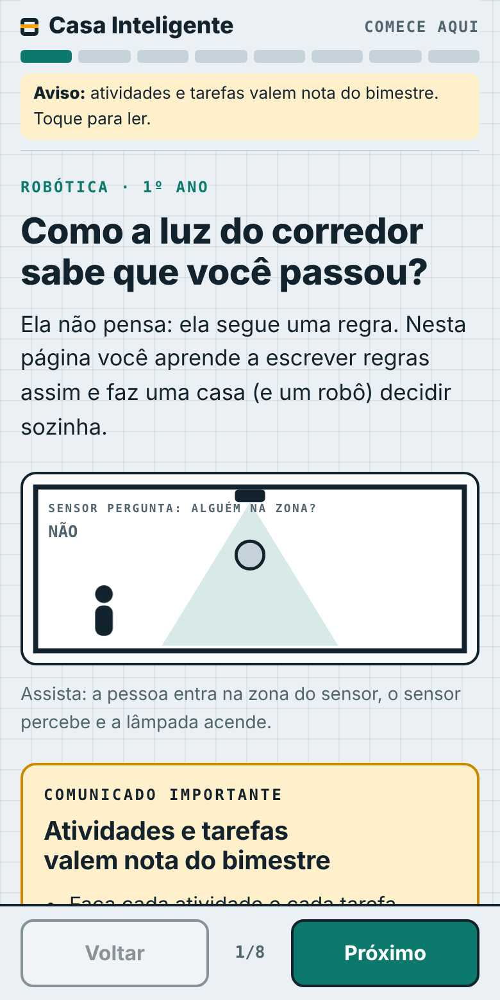
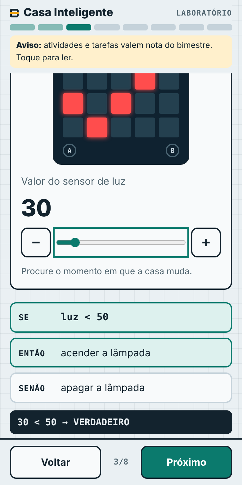
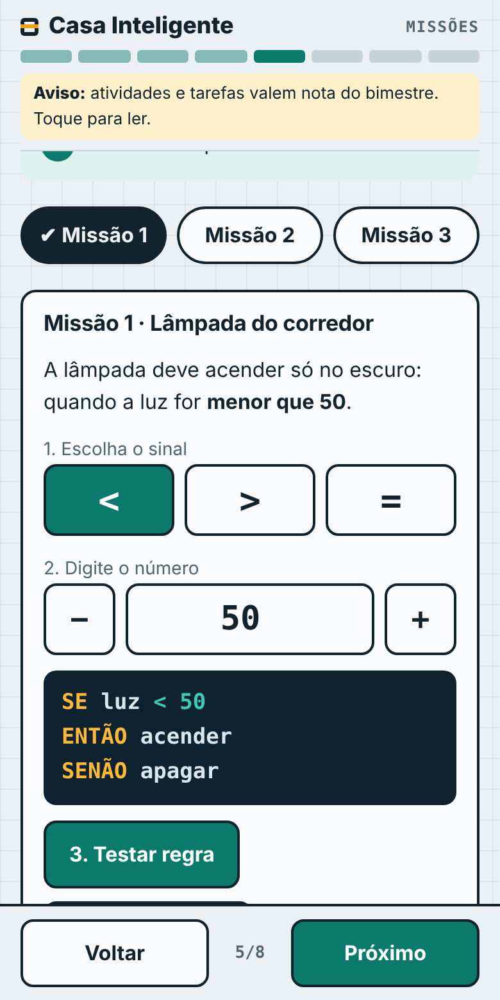
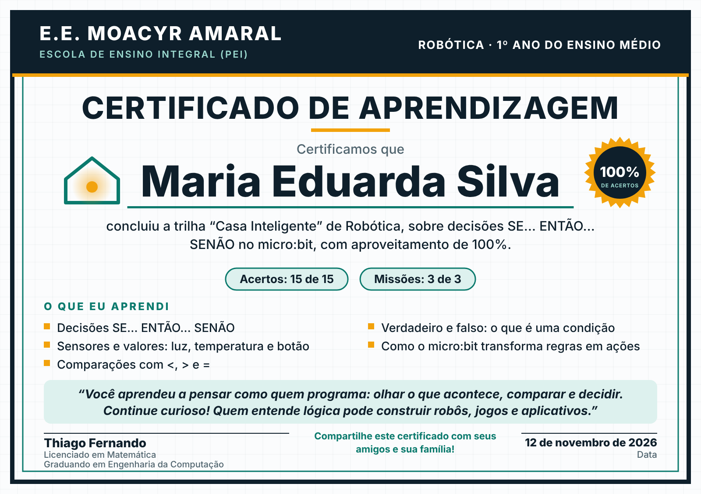

<p align="center">
  
</p>

<h1 align="center">Casa Inteligente</h1>

<p align="center">
  Material de apoio interativo de <b>Robótica</b> para o <b>1º ano do Ensino Médio</b>:<br>
  aprenda a fazer o micro:bit decidir com <b>SE… ENTÃO… SENÃO</b>.
</p>

<p align="center">
  <a href="https://thiago-spba.github.io/casa-inteligente-1ano/"></a>
</p>

<p align="center">
  
  
  
  
</p>

---

## Sobre

O aluno aprende como um sensor, um número e uma regra viram uma ação: **SE** a luz for menor que 50, **ENTÃO** acende a lâmpada, **SENÃO** apaga. Tudo acontece numa planta de casa vista de cima, com animações, simulador e jogo, sem precisar de micro:bit na mão.

A página foi feita para **aulas remotas e estudo em casa**, no celular ou no computador. Cada tela começa com um quadro **"Faça assim"** que explica o que fazer, passo a passo.

<p align="center">
  
</p>

## O que o aluno aprende

- Decisões **SE… ENTÃO… SENÃO** (estrutura condicional)
- Sensores e valores: luz, temperatura e botão do micro:bit
- Comparações com **<**, **>** e **=**
- Verdadeiro e falso: o que é uma condição
- Como o micro:bit transforma regras em ações (código MakeCode)

Conteúdo de pensamento computacional e Robótica, alinhado ao **Currículo Paulista**.

## A trilha

| Etapa | O que o aluno faz |
| :-- | :-- |
| **Comece aqui** | Assiste à animação, lê o comunicado sobre tarefas e vê o mapa da trilha |
| **1 · Entenda** | Acompanha a decisão passo a passo e abre as definições, do básico ao complexo |
| **2 · Laboratório** | Mexe no sensor (luz, temperatura, botão A) e vê a casa e o micro:bit reagirem |
| **3 · Jogo** | Verdadeiro ou falso, em 10 rodadas, com explicação a cada resposta |
| **4 · Missões** | Monta a regra certa (sinal e número) e confere nos testes ✔ e ✘, com dicas |
| **5 · Questões** | 5 questões com "Como resolver" e o porquê de cada alternativa |
| **6 · Em casa** | Acha 3 decisões escondidas em aparelhos da casa e confere a lista de tarefas |
| **7 · Certificado** | Com 60% ou mais de acertos, gera o certificado com o próprio nome |

## Destaques

- **Animações e interatividade:** abertura animada, máquina de decisão, laboratório com sensores e jogo.
- **Aviso sobre tarefas:** comunicado de que atividades e tarefas valem nota do bimestre, com lista de conferência.
- **Certificado de aprendizagem:** gerado na hora, em imagem, para salvar, imprimir ou compartilhar.
- **Responsivo:** funciona de telas de 320 px a monitores grandes, sem rolagem lateral.
- **Tema claro e escuro:** acompanha a configuração do aparelho.
- **Acessível:** botões grandes, foco visível, rótulos para leitores de tela e animações reduzidas quando o aparelho pede.

## Prévia

<table align="center">
  <tr>
    <td align="center"><br><sub>Comece aqui</sub></td>
    <td align="center"><br><sub>Laboratório</sub></td>
    <td align="center"><br><sub>Missões</sub></td>
  </tr>
</table>

### Certificado de aprendizagem

<p align="center">
  
  <br><sub>Exemplo com nome fictício.</sub>
</p>

## Como usar

Não precisa instalar nada.

1. **Online:** abra o link da aula (botão no topo).
2. **Offline:** baixe o `index.html` e abra no navegador. Sem internet, a página usa as fontes do próprio aparelho.

## Tecnologias

- HTML, CSS e JavaScript puros, em **um único arquivo** (`index.html`)
- SVG e CSS para as animações
- Canvas para gerar a imagem do certificado
- Fontes Bricolage Grotesque, Figtree e JetBrains Mono (Google Fonts, com alternativas do sistema)

## Estrutura

```text
.
├── index.html   # a aula completa (HTML, CSS e JS)
├── assets/      # banner, fluxo animado e imagens da prévia
└── README.md
```

## Autor

**Thiago Fernando**<br>
Licenciado em Matemática · Graduando em Engenharia da Computação
